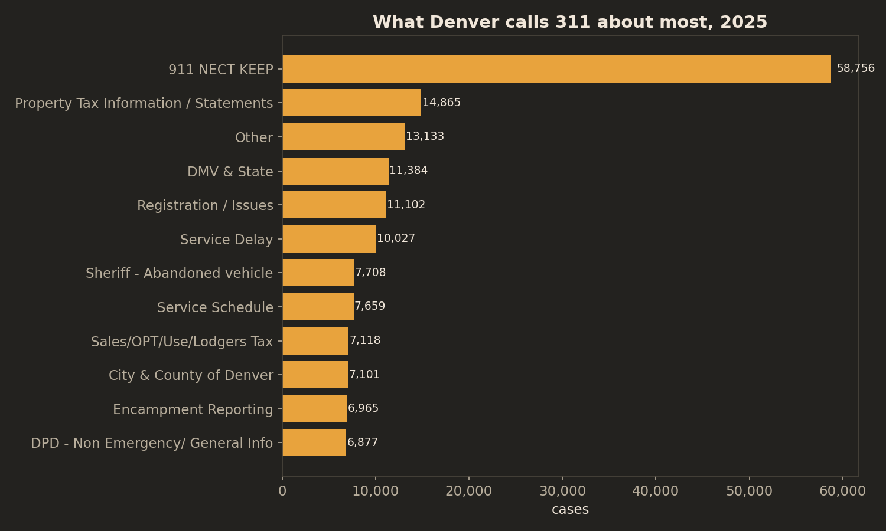

# The 311 Report Card: What 1.38 Million Calls Say About Denver's City Services

*Three years of Denver 311 data (2023-2025), the auditor's August 2025 case-management audit, and the question every council member should ask during budget season: who waits longest for the city to answer?*

## The bottom line

Denver's 311 system handled roughly **1.38 million cases** from 2023 through 2025 — about 1,260 a day. Most of what it does is answer questions, not dispatch trucks: **84% of cases close the same day they're opened**, and the single largest category isn't potholes or trash, it's 911 non-emergency call-taking. The system is, in large part, the city's front desk.

But the front desk doesn't serve everyone equally fast. Among cases assigned to council districts — the field-work cases like weeds, potholes, and abandoned vehicles — the median wait in District 6 (1.76 days) is **more than triple** the median in District 11 (0.49 days). And the city's own auditor found in August 2025 that 311's case management is "informal and siloed," with no formal agreements governing how partner agencies handle the cases 311 routes them — thirteen years after the auditor first flagged the same problem.

## Finding 1: Denver mostly calls 311 for information, not services

The top case category in 2025 was **"911 NECT KEEP"** — 58,756 cases, 13% of the entire system. NECT stands for Non-Emergency Communication Technician: these are 911 non-emergency calls logged through the 311 system. The next largest categories are property-tax questions, DMV and vehicle registration, and abandoned vehicles.

This reframes what 311 is. The public image is potholes and missed trash pickup. The data says it's mostly residents asking the city questions — about their tax bill, their plates, a car that's been sitting too long — and getting an answer the same day. In 2023, the single largest category was "Online Report, General Info" (42,163), the 311 web portal's catch-all.

## Finding 2: Encampment reports didn't fall in late 2025 — the label changed

"Encampment Reporting" cases dropped from ~900 a month to ~200 a month in the last quarter of 2025. That looks like dramatic progress. It isn't: in September 2025 the city introduced a new category, **"Encampment / Street Engagement,"** and cases migrated to it. Combined, the two categories hold steady at roughly 700-900 a month through year-end.

This is exactly the kind of artifact that makes 311 data treacherous for accountability. A naive chart of "encampment reports" shows a collapse; the real series shows nothing changed. Anyone measuring the city's homelessness response off 311 data needs to know the labels moved.

## Finding 3: Same kind of case, different wait by district

Filtering to cases geocoded to a council district — the field-work cases (weeds and vegetation violations, abandoned vehicles, potholes, encampments) rather than the informational calls that dominate the system — resolution times spread more than 3x:

District 11's median is 0.49 days with 61% closed same-day; District 6's median is 1.76 days with only 45% closed same-day. The slowest tenth of cases waits nearly 27 days in Districts 4 and 6, versus 16 in District 11. These are the same categories of work, in the same city, in the same year. The gap is the service, not the request.

Two caveats that matter. First, 82% of 2023 cases carry no district at all (coded "0") — those are overwhelmingly the instant-answer informational cases, so the district comparison is among the field-work subset, which is the right comparison but not the whole system. Second, district geography degrades in the newer files (17% populated in 2024, 26% in 2025), so cross-year district trends can't be trusted — which is itself a data-quality finding worth a council question.

## Finding 4: Volume is flat, speed is steady

Total cases: 474,695 (2023) → 455,214 (2024) → 451,943 (2025). Same-day closure held at 83-85% across all three years. Whatever the audit found wrong with 311's management, it isn't showing up as collapsing throughput — the system answers at about the same speed it did three years ago.

## The audit, a year later: early signal, not verdict

The auditor's August 2025 report put numbers on first-contact resolution: 59% of 311-agent-created cases resolved at first contact in 2023, rising to 67% in 2024. The public data in this brief can't reproduce the auditor's exact metric — their denominator is cases created by 311 agents under a Salesforce-based definition, while the published file's "First Call Resolution" flag reads 98% "Y," plainly a different and far looser definition. Directionally, the public data is consistent with the audit's improving trend (same-day closure ticked from 83.0% to 84.5%), but that is an early signal, not proof the city's response worked. The audit is two months old.

## What this does not prove

Case Summary is free text entered by agents — categories shift over time (see Finding 2), and "911 NECT KEEP" appears to have been introduced around April 2024, so year-over-year comparisons for that category understate 2024. The published Topic, Type, Major Area, Division, and Neighborhood fields are blank in all three files; topics here are derived from the Case Summary text. Resolution time measures case open-to-close, not time-to-fix: a pothole case closed as "answer provided" may still have a pothole. And none of this measures whether residents got the *right* answer — the audit's finding that 39% of compost-bin messages were off-topic is about quality, which timestamps can't see.

## Methods

Three public yearly snapshots from Denver's ArcGIS Hub (opendata-geospatialdenver.hub.arcgis.com): 311 Service Requests 2023 (feature service, 474,695 records), 2024 (CSV, 455,214 rows), 2025 (CSV, 451,943 rows). Fields used: Case Summary, Case Status, Case Created/Closed dttm, Council District, Agency, Case Source. Resolution time = closed dttm minus created dttm for cases with valid dates on both ends (89-94% of rows per year). District analysis uses 2023 (complete district coding); 2024/2025 district fields are sparsely populated and excluded from cross-year comparison. Analysis in Python (pandas/matplotlib); download and analysis code plus aggregated outputs in this repo.

## Data sources

All public, City and County of Denver via ArcGIS Hub:
- 311 Service Requests 2023 (feature service)
- 311 Service Requests 2024 (CSV)
- 311 Service Requests 2025 (CSV)
- Denver Auditor, "Denver 311 and Select Agency Case Management," August 2025 (audit at a glance)

## Reproduce

1. Download the three yearly files from Denver's ArcGIS Hub (see Data sources)
2. Run `python code/download_2023.py` for the 2023 feature service (or place files in `data/`)
3. Run `python code/analyze.py [years]`
4. Run `python code/charts.py`
5. Charts land in `charts/`; aggregates in `output/stats.json`

Requires Python 3 with matplotlib.
